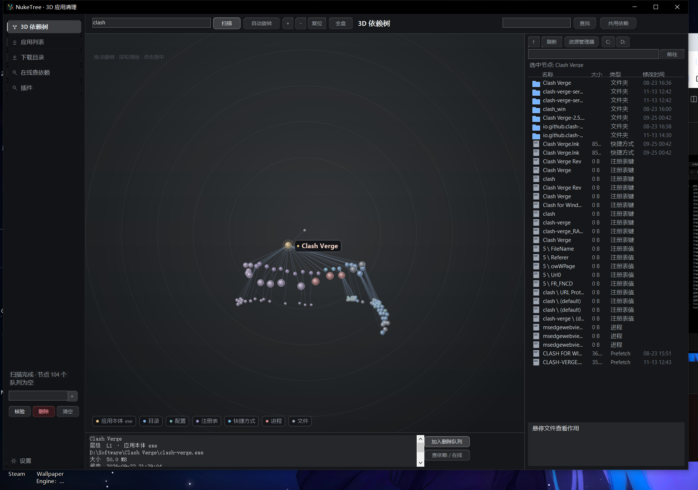
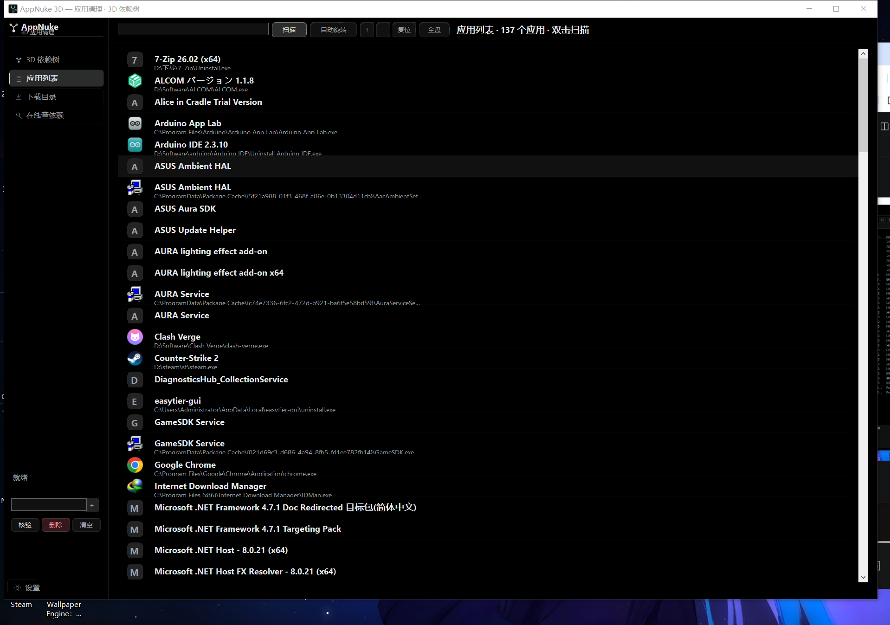
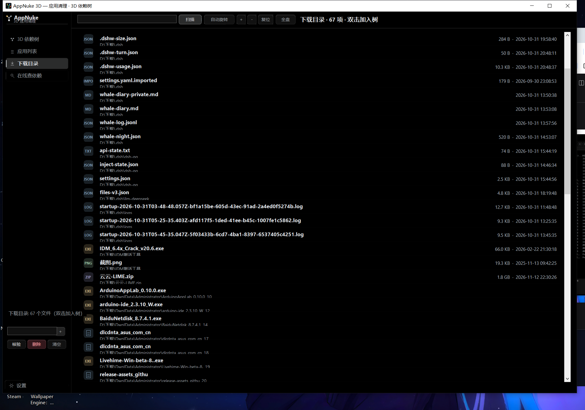
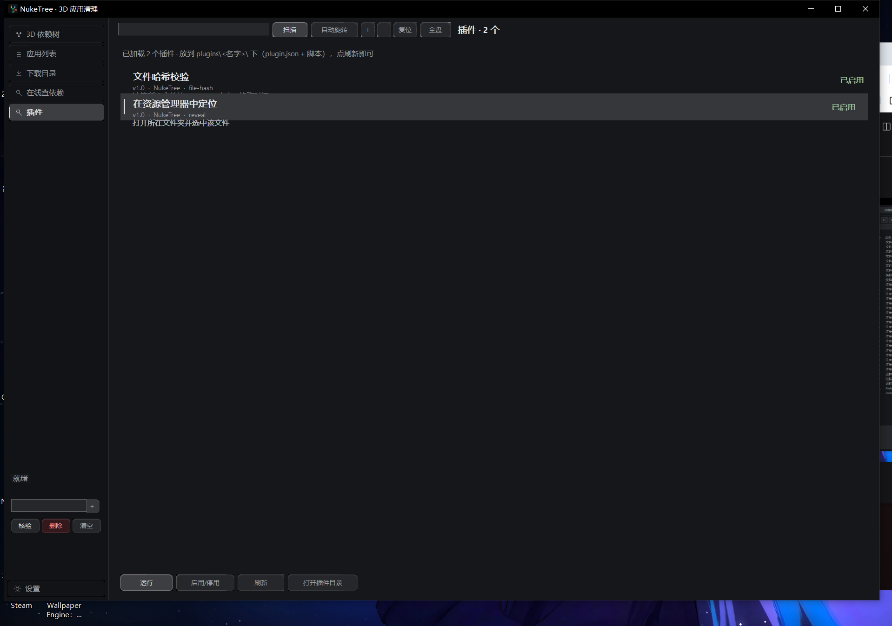
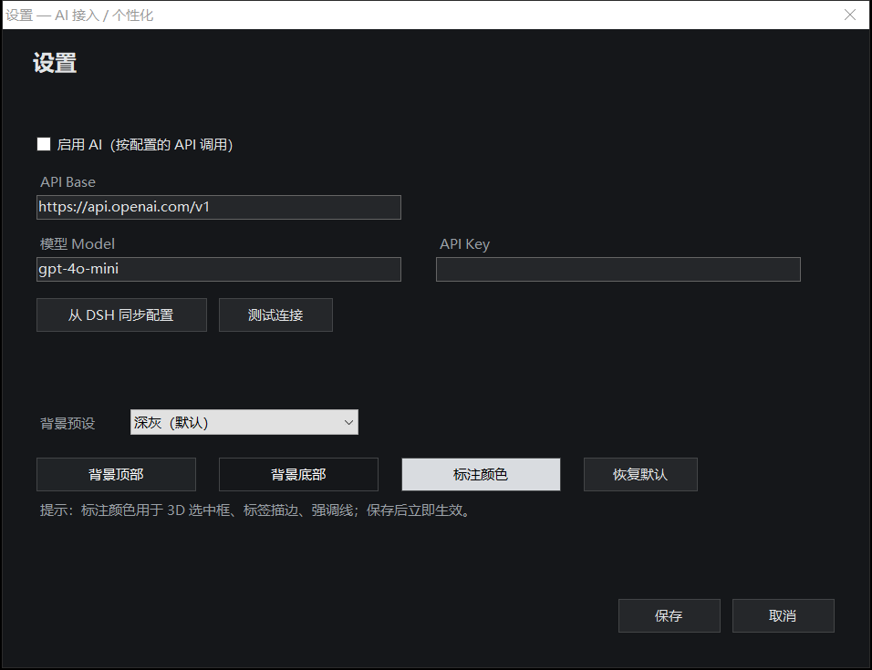

# NukeTree · 3D 应用彻底清理

一款 Windows 原生（WinForms / .NET Framework）应用清理工具：把应用、文件夹、注册表、服务、进程等依赖关系放进一张可交互的 **3D 放射状依赖树**，边看边删；删除前自动备份，删除后核对磁盘回收空间与残留项。

> 无 Electron / 无浏览器内核，单 exe + PowerShell 后端，启动即用。



## 功能

### 3D 依赖树
- 应用本体、目录、配置、注册表键/值、快捷方式、进程、Prefetch 统一建模
- **放射状不规则直线** 连线，球体按层级自动分布、防重叠；支持拖拽旋转、滚轮/按钮缩放、自动旋转
- **全盘总览**：按磁盘聚合全部文件，双击逐层展开，不会一次铺满成"乱麻"
- **拖拽**：从资源管理器把文件/文件夹拖进 3D 画布，直接加入树
- **3D 内查找**：按名字/路径搜索并高亮命中节点
- 选中节点时其它分支自动淡化，突出当前依赖链

### 清理与验收
- 搜索应用 → 生成依赖树 → 勾选入删除队列 → 彻底删除
- 删除前自动备份到 `备份3D\del_<时间>\`（文件 + 注册表导出）
- 删除后自动核验：
  - 磁盘可用空间 `删除前 → 删除后`（实际回收）
  - 残留检测：注册表卸载项 / 服务 / 计划任务 / 启动项 / Prefetch / AppData·ProgramData 残留目录
  - 进程与内存占用
- 受保护路径（`C:\Windows`、`.dsh`、`Common Files`、`WindowsApps` 等）自动跳过

### 共用依赖检测
- 一键分析当前应用依赖，标出**被其它应用或系统共用**的 DLL/EXE
  （例：`UnityPlayer.dll` 被 Steam 与 VRChat 共用、`chrome_elf.dll` 被 Chrome 与壁纸引擎共用）
- 共用项在 3D 中高亮，避免误删导致其它软件损坏

### AI 文件作用提示
- 鼠标悬停 3D 球体或文件行 → 显示路径、类型、大小、**作用**
- 未配置 AI 时使用内置规则库（按扩展名/目录/文件名判断），离线可用
- 设置里可填写任意 OpenAI 兼容 API（Base / Model / Key），或「从 DSH 同步配置」

### 个性化与插件
- 背景预设（深灰/纯黑/深蓝/暖褐）、自定义背景顶部/底部色、标注色
- **插件系统**：`plugins/<id>/plugin.json` + 脚本（PowerShell / exe），可对选中节点执行；支持启用/停用
- 字体与 DSH Web UI 一致（Segoe UI + 微软雅黑回退），暗色标题栏、无多余 Logo

## 界面

| 应用列表 | 下载目录 |
|---|---|
|  |  |

| 插件 | 设置 |
|---|---|
|  |  |

## 构建

要求：

- Windows 10 / 11 x64
- .NET Framework 4.x（自带 `csc.exe`）
- PowerShell 5.1（后端使用 `TcpListener`，不依赖 http.sys）

```powershell
# 在仓库根目录
powershell -NoProfile -ExecutionPolicy Bypass -File build.ps1
# 产物：dist\NukeTree.exe（同目录含 NukeTree.ps1、plugins、图标）
```

直接运行 `dist\NukeTree.exe`；删除系统目录/服务请以管理员身份运行。

## 插件开发

目录结构：

```
plugins/
  my-plugin/
    plugin.json
    run.ps1        # 或任意 exe
```

`plugin.json`：

```json
{
  "name": "文件哈希校验",
  "version": "1.0",
  "description": "计算所选文件的 SHA256 / 大小 / 修改时间",
  "author": "your-name",
  "command": "run.ps1",
  "args": "\"{path}\""
}
```

- `command`：脚本（`.ps1` 自动用 PowerShell 执行）或 exe 路径
- `args`：支持占位符 `{path}`（选中节点完整路径）、`{name}`（节点名）
- 插件页可「运行 / 启用停用 / 刷新 / 打开插件目录」；启用状态保存在 `plugins/state.json`

内置示例：`file-hash`（文件哈希）、`reveal`（资源管理器定位）。

## 本地 API

应用启动时会在 `http://127.0.0.1:18765` 启动本地后端（仅本机可访问）：

| 接口 | 说明 |
|---|---|
| `GET /api/apps` | 已安装应用列表（含 exe 图标路径） |
| `GET /api/scan?kw=` / `?path=` | 构建依赖树 / 浏览目录 |
| `GET /api/downloads?kw=` | 下载目录文件 |
| `GET /api/online?kw=` | 在线依赖查询链接 |
| `GET /api/shared?kw=` | 共用依赖分析 |
| `GET /api/residue?kw=` | 残留检测 |
| `GET /api/verify?kw=&paths=` | 删除后核验 |
| `POST /api/delete` | 备份并删除（JSON 数组） |

## 发布

完整的发布流程（GitHub Release / npm / GitHub Packages）见 [PUBLISH.md](PUBLISH.md)。

一键生成发布包（构建 + 便携版 zip + 安装版 zip + sha256）：

```powershell
powershell -NoProfile -ExecutionPolicy Bypass -File .\scripts\make-release.ps1 -Version 1.0.0
```

## 安全说明

- 删除前自动备份，可从 `备份3D\` 恢复文件与注册表
- 受保护路径与系统共享注册表默认跳过
- 删除系统组件、服务前请确认目标，误删可能影响系统稳定
- 本工具本身不联网；AI 功能仅在你主动配置 API 后才会请求你指定的服务

## License

MIT — 见 [LICENSE](LICENSE)。
